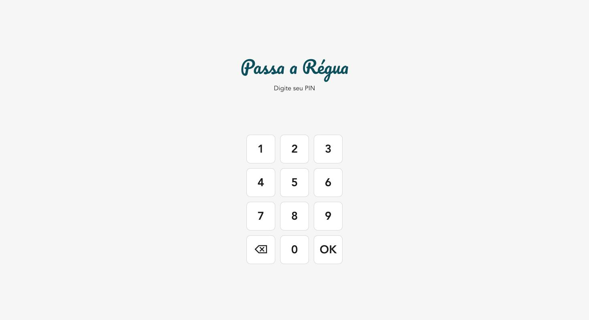
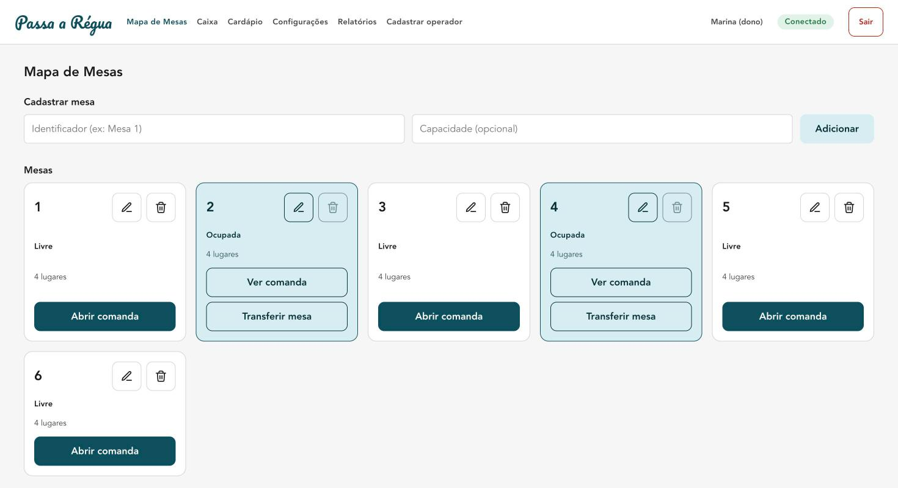
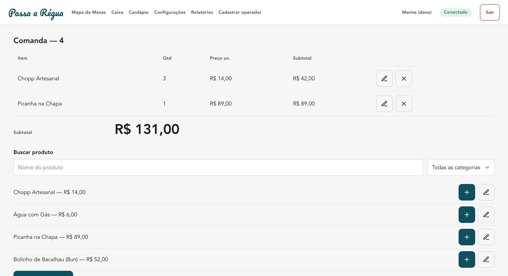
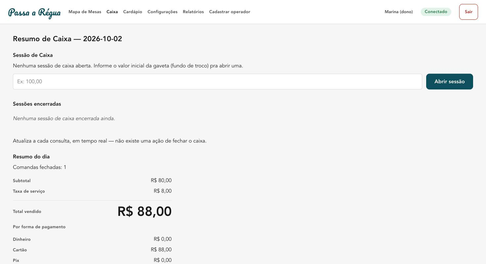

<div align="center">


# Passa a Régua

**PDV desktop offline-first para bares e restaurantes** — mesas, comandas, cardápio, caixa e sincronização multi-terminal sem depender de internet estável.

[](https://github.com/jrsousa95/passa-a-regua/actions/workflows/ci.yml)


</div>

---

## Screenshots

<table>
<tr>
<td width="50%"><br/><sub>Login por PIN, 100% offline</sub></td>
<td width="50%"><br/><sub>Mapa de Mesas — livre/ocupada</sub></td>
</tr>
<tr>
<td width="50%"><br/><sub>Comanda — busca de produto, itens, subtotal</sub></td>
<td width="50%"><br/><sub>Resumo de Caixa — por forma de pagamento</sub></td>
</tr>
</table>

## O que é

Um sistema de ponto de venda completo para bares/restaurantes pequenos: mapa de mesas, abertura e fechamento de comanda, cardápio, split de conta, sessão de caixa com sangria/suprimento, relatórios (por período, operador, produto) e sincronização entre múltiplos terminais — tudo funcionando **sem internet**, sincronizando quando a rede volta.

Construído sozinho, do zero, cobrindo o ciclo completo: brief → PRD → arquitetura → UX → épicos/stories → implementação → QA de concorrência → hardening de segurança → empacotamento Windows validado em CI real.

## Por que é tecnicamente interessante

A decisão central do projeto: **cada terminal mantém um log de eventos append-only local (SQLite), e "sincronizar" significa trocar e mesclar esses logs** — não importa se o peer é outro terminal na mesma rede (LAN, via mDNS) ou o backend na nuvem (Postgres). Os dois usam **o mesmo protocolo de replicação**, só o transporte muda.

Isso dá:

- **Offline-first de verdade.** Qualquer terminal funciona sozinho, full-featured, sem rede nenhuma. Nada bloqueia em "carregando..." esperando um servidor.
- **Conflitos resolvidos automaticamente, sem intervenção humana.** Dois garçons abrindo comanda na mesma mesa ao mesmo tempo, em terminais que nunca se viram? Um Hybrid Logical Clock (HLC) ordena os eventos causalmente; a reconciliação escolhe a comanda canônica deterministicamente (menor HLC) e mescla os itens da perdedora — os dois terminais chegam ao mesmo estado final, sem servidor nenhum precisar arbitrar.
- **Camada de leitura inteiramente derivada e descartável.** As tabelas "normais" (mesas, comandas, itens) nunca são a fonte de verdade — são projeções recalculadas a partir do replay dos eventos em ordem de HLC. Pode apagar e reconstruir a qualquer momento.
- **O mesmo motor de eventos roda nos dois lados.** `packages/sync-engine` (HLC, reconciliação, projeção) é compartilhado byte-a-byte entre o sidecar local (Node embutido no app via Tauri) e o backend na nuvem — zero lógica de domínio duplicada entre "local" e "servidor".

Validado com testes de concorrência reais (dois+ sidecars de verdade, não mocks, trocando eventos por LAN) e uma rodada de hardening de segurança (timing-safe comparison em token/PIN, bind de rede corrigido, revisão de HTTPS).

## Stack

| Camada | Tecnologia |
|---|---|
| Desktop app | [Tauri 2](https://tauri.app/) (Rust, só pra empacotamento/IPC) + React 19 + TypeScript + Vite |
| Motor local | Sidecar Node.js embutido (Single Executable Application), SQLite, servidor HTTP próprio |
| Sync engine | `packages/sync-engine` — HLC, event sourcing, reconciliação determinística, compartilhado local↔nuvem |
| Backend cloud | Node.js + PostgreSQL (projeção materializada em JSONB), mesmo protocolo de replicação do sync LAN |
| Testes | Vitest (unidade), cenários de concorrência multi-terminal reais (`node:test`), CI no GitHub Actions |

## Arquitetura (visão rápida)

```
┌─────────────────┐       LAN (mDNS)        ┌─────────────────┐
│   Terminal A     │◄───────────────────────►│   Terminal B     │
│ React + Sidecar  │   mesmo protocolo de     │ React + Sidecar  │
│  Node + SQLite   │   replicação de eventos  │  Node + SQLite   │
└────────┬─────────┘                          └────────┬─────────┘
         │                                              │
         │              HTTPS (mesmo protocolo)         │
         └──────────────────┐        ┌───────────────────┘
                             ▼        ▼
                      ┌──────────────────┐
                      │  Backend (cloud)  │
                      │  Node + Postgres  │
                      │ (peer permanente, │
                      │  plano/relatórios)│
                      └──────────────────┘
```

Detalhes completos em [`docs/architecture.md`](docs/architecture.md) (modelo de dados, protocolo de reconciliação, decisões de segurança) e [`docs/prd.md`](docs/prd.md) (requisitos, épicos, critérios de aceite).

## Funcionalidades

- **Autenticação por PIN** com papéis (garçom / caixa / dono) e permissões diferenciadas
- **Mapa de mesas** — abrir, transferir, conflito resolvido automaticamente
- **Comandas** — busca de produto, cancelamento com auditoria, nota por item
- **Fechamento** — taxa de serviço configurável, split de conta, troco, múltiplas formas de pagamento
- **Sessão de caixa** — abertura com fundo de troco, sangria/suprimento, fechamento com conferência (contado × esperado)
- **Relatórios** — por período (com comparativo), por operador, por produto (curva ABC), exportação CSV
- **Cardápio** — categorias e produtos, ativo/inativo
- **Multi-terminal** — sincronização LAN + nuvem, resolução de conflito, relatório consolidado (ver nota abaixo)
- **Gestão de plano** — limite de terminais/comandas simultâneas, aplicado no backend, configurável sem redeploy

> **Nota:** a UI de pareamento de terminais (e as telas que só fazem sentido com 2+ terminais) está escondida nesta build pública — é a funcionalidade pensada como gancho de upgrade pago, e ainda não existe nenhum fluxo de cobrança implementado. O motor de sincronização em si continua ativo e testado; só a entrada na interface está atrás de uma flag (`apps/desktop/src/lib/feature-flags.ts`).

## Status do projeto

MVP **funcionalmente completo e validado** — todos os épicos planejados (autenticação, mesas/comandas, cardápio, pedidos, fechamento, caixa, sync multi-terminal, gestão de plano, evolução de fluxo de caixa) estão implementados, testados e documentados.

**Não é um produto em produção.** Faltam, deliberadamente fora do escopo até aqui: infraestrutura de deploy do backend (roda só local/dev hoje), gateway de pagamento/cobrança real, assinatura de código do instalador (Windows/macOS), mecanismo de auto-update, e conformidade legal (LGPD, termos de uso). Este repositório é uma demonstração de engenharia ponta a ponta, não um produto pronto pra baixar e vender.

## Rodando localmente

Pré-requisitos: Node 24+, Docker (pro Postgres local), [toolchain do Tauri](https://tauri.app/start/prerequisites/) (Rust + dependências da plataforma).

```bash
# instala tudo (monorepo com workspaces npm)
npm install

# builda os pacotes compartilhados (sync-engine, shared-types)
npm run build --workspace=@passa-a-regua/shared-types
npm run build --workspace=@passa-a-regua/sync-engine

# app desktop (Tauri) — abre a janela nativa com o sidecar embutido
npm run dev:tauri

# backend (opcional, só necessário pra testar sync multi-terminal/nuvem)
docker compose up -d postgres
npm run dev --workspace=@passa-a-regua/backend
```

### Testes

```bash
npm test --workspace=@passa-a-regua/sync-engine      # unidade: HLC, reconciliação, relatórios
npm test --workspace=@passa-a-regua/shared-types      # unidade: schemas de evento
npm run test:concurrency --workspace=@passa-a-regua/sidecar  # multi-terminal real via LAN
```

## Estrutura do monorepo

```
apps/
  backend/            API de sync com a nuvem (Node + Postgres)
  desktop/            App Tauri (React/Vite) + sidecar Node embutido
    sidecar/          Servidor HTTP local, SQLite, sync LAN
packages/
  sync-engine/        HLC, event sourcing, reconciliação — o núcleo técnico
  shared-types/       Schemas de evento compartilhados (Zod)
docs/
  prd.md              Requisitos de produto, épicos, critérios de aceite
  architecture.md      Decisões de arquitetura e modelo de dados
```

## Processo de desenvolvimento

Projeto solo, desenvolvido com um fluxo spec-first assistido por IA (BMAD method): cada funcionalidade nasce de um PRD/arquitetura revisados, vira uma spec com critérios de aceite explícitos, passa por implementação e múltiplas rodadas de revisão adversarial (bugs, edge cases, gaps de verificação) antes de ser considerada pronta. `docs/implementation-plan.md` documenta cada milestone, incluindo achados reais de bugs e decisões corrigidas ao longo do caminho — não só o resultado final.

## Licença

Todos os direitos reservados. Código disponível publicamente para fins de avaliação (portfólio) — uso, cópia, modificação ou redistribuição não são autorizados sem permissão explícita do autor.

## Autor

**Eudes Junior** — [github.com/jrsousa95](https://github.com/jrsousa95)
